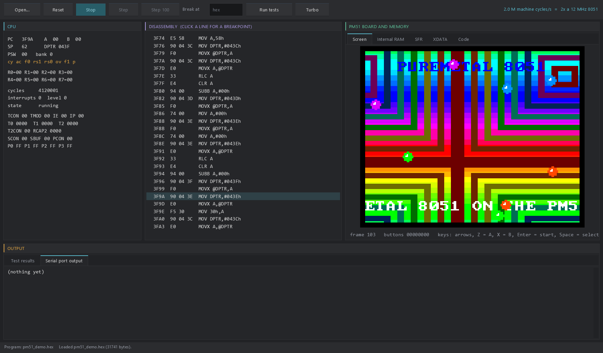
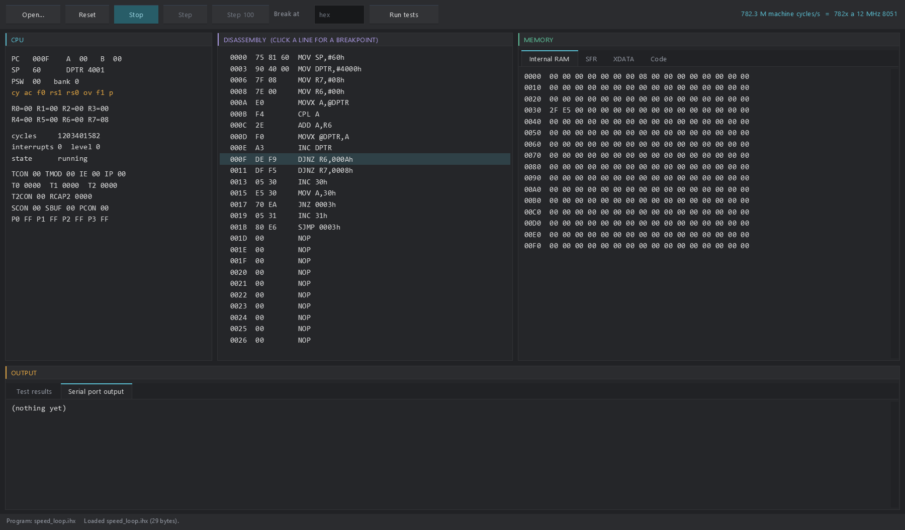

# 8051 Emulator for the Raspberry Pi Pico Series

A fast, cycle-counted Intel 8051 / 8052 (MCS-51) emulator for the Raspberry Pi
Pico W (RP2040) and the RP2350 boards, written in PureMetal and compiled with
PureMetal Forge. It
comes with **the PM51 display board** - a small 8051 computer with a 160x128
picture, text, sprites, three-voice sound and buttons - shown at 60 frames a
second on a 480x320 ST7796 panel, with both Pico cores at work, and a
**Windows desktop version** with a debugger. Everything here was measured on
real boards.



## Features

- **The whole MCS-51 instruction set**: all 255 opcodes, every addressing mode,
  register banks 0-3, PSW with parity, MUL / DIV / DA with the manual's flag
  rules. `$A5`, the one undefined opcode, stops the CPU on it.
- **8051 and 8052**: 128 or 256 bytes of internal RAM, separate 64 KB code and
  XDATA spaces, the SFR and bit spaces, timer 2 on the 8052.
- **Interrupts with both priority levels**, polled in the chip's order, with the
  "one more instruction after RETI or an IE/IP write" rule.
- **Timers 0, 1 and 2** in every mode (timer/counter, GATE, mode 3, auto-reload,
  capture, baud-rate generator), the **serial port** (modes 0-3, SM2, REN),
  **ports** that read the latch or the pins as the chip does, **PCON** idle and
  power-down.
- **Machine-cycle timing** in a timed build (12 clocks a cycle, the Intel
  instruction table), or an untimed build that counts instructions and runs
  fastest.
- **Fast**: computed-goto dispatch through a 256-entry `.Label` table, every
  handler with its own dispatch tail, the whole loop in SRAM. On the RP2350 the
  hot opcodes are hand-written **Thumb-2**.
- **Hooks** for code, XDATA, SFR and serial access, so the core can sit inside
  any machine you build around it.
- **Two cores** on the PM51 board: core 0 runs the 8051, core 1 draws the panel
  by DMA (and drives the Bluetooth radio when a speaker is on).
- **Verified** against 7,680 single-instruction vectors, programs compiled by
  PureMetal Forge's own 8051 target with exact cycle counts, and interrupt,
  timer and serial programs - on silicon, in every build.

## Supported boards

| Board | Chip | Status |
|---|---|---|
| Raspberry Pi Pico W + LAFVIN ST7796 3.5" panel kit | RP2040, 200 MHz | everything tested: core, PM51 board at 60 fps, Bluetooth sound |
| Raspberry Pi Pico 2 W + LAFVIN ST7796 3.5" panel kit | RP2350, 150 MHz | core and PM51 board at 60 fps tested; no sound yet |
| Adafruit Feather RP2350 | RP2350, 150 MHz | core tested (test suites, benchmarks); no panel wiring |

The panel is a 480x320 ST7796 on SPI0 (SCK GP2, MOSI GP3, CS GP5, DC GP6,
RST GP7); the kit's stick (GP26/GP27) and buttons (GP15, GP14) are the
board's controls.

## Performance

### The PM51 board on the panel (60 Hz machine)

Busy is the share of every 5 seconds a core spends working; the rest it waits.

| Board | Panel format | Machine frames / panel frames per second | Core 0 busy | Core 1 busy |
|---|---|---:|---:|---:|
| Pico W | 16 bits a pixel, SPI 100 MHz | 60 / 60 | 33% | 87% |
| Pico 2 W | 12 bits a pixel, SPI 75 MHz | 60 / 60 | 30% | 88% |

Core 0 runs the board by the wall clock and, after each frame, copies the
picture's memory into a snapshot (0.6 ms), so the panel always shows one whole
emulated frame. Core 1 sends every snapshot whole - one 320x256 window, 128
DMA transfers from two line buffers - while it composes the next line. The
RP2350 is specified to 150 MHz, which limits its SPI to 75 MHz, too slow for
160 KB of 16-bit pixels sixty times a second; on the RP2350 the panel
therefore runs at 12 bits a pixel, which holds every PM51 colour (RGB332)
exactly. With the Bluetooth speaker on (Pico W, measured at the board's
earlier 50 Hz): every frame on the panel, about 125 audio packets a second,
no underruns.

### The CPU core

One million instructions per mix, untimed build:

| Instruction mix | Pico W (RP2040, Thumb-1) | Pico 2 W (RP2350, Thumb-2) |
|---|---:|---:|
| `DJNZ R7,$` / `SJMP` | 4.36 M instructions/s | 6.53 M |
| `ADD #` / `ADDC Rn` / `XRL #` / `RLC A` / `SUBB Rn` | 3.91 M | 6.34 M |
| `MOV A,@R0` / `MOV dir,A` / `MOV dir,dir` / `INC R0` / `CJNE` | 4.14 M | 7.17 M |
| `MOVX` / `CPL A` / `INC DPTR` / `MOV A,DPH` / `CJNE` | 4.55 M | 5.39 M |

Programs compiled by PureMetal Forge's 8051 target, timed build:

| Program | Pico W | Pico 2 W |
|---|---:|---:|
| fibcrc (32-bit Fibonacci, CRC-16, gcd) | 9.68 M machine cycles/s | 12.0 M |
| primes (sieve below 2000) | 8.63 M | 10.6 M |
| sort (bubble sort of 48 words) | 8.48 M | 10.5 M |

A 12 MHz 8051 runs 1 million machine cycles a second, so compiled code runs
about **8.5 to 12 times as fast as an original 8051**. The PM51's 24 MHz 8052
(2 M cycles a second) takes a third of core 0.

On the RP2350 the dispatch tail fetches through a code-base register and jumps
with `ldr pc, [r6, r2, lsl #2]` (four instructions from fetch to the next
handler), and 138 hot opcodes are written in Thumb-2 by hand
(`tools/thumb2_handlers.py`), each keeping its PureMetal version as the
reference. That made the core 48-62% faster on the hot mixes and compiled
programs about 22% faster than the RP2040-style core on the same chip
(`docs/pico2-thumb2-benchmark.log`, `docs/pico2w-ldrpc-benchmark.log`). The
RP2040 keeps its Thumb-1 tail.

### Desktop

On a desktop PC the same core, generated as PureBasic with a labels-as-values
dispatch, runs 298-495 M instructions a second (untimed) and 536-730 M machine
cycles a second (timed) - several hundred times an original 8051.

## Quick start: put it on a Pico

1. Hold **BOOTSEL** while plugging the Pico in; it appears as a USB drive.
2. Copy one of these onto it:

| File | Board | What it runs |
|---|---|---|
| `firmware/pm51-picow.uf2` | Pico W + ST7796 panel | the PM51 board with its demo, silent |
| `firmware/pm51-pico2w.uf2` | Pico 2 W + ST7796 panel | the PM51 board with its demo |
| `firmware/8051-picow.uf2` | Pico W | the core's self-test and benchmark, on USB serial |
| `firmware/8051-pico2w.uf2` | Pico 2 W | the same for the RP2350 |

The board restarts into the program. The PM51 firmware reports once every 5
seconds on the Pico's USB serial port (any terminal, any baud rate): machine
frames, panel frames, each core's busy share, interrupts and the buttons.

**Controls (LAFVIN kit)**: the stick is up / down / left / right, BTN1 is A,
BTN2 is B, both buttons together are Start.

No ROMs are needed or included: the PM51 is a machine of its own, and its demo
is a PureMetal program in this repository. Any 8051 program you have the right
to run - your own, or one under a free licence - can be loaded (see
"Running your own 8051 program").

## The PM51 display board

A small 8051 computer defined for this emulator, so that programs have a
screen, sound and buttons. It is reached the way an 8051 reaches hardware:
MOVX into XDATA, and port P1. PureMetal Forge has the board as a target ("PM51
display board (8052, 24 MHz)", source extension `.pm51`), which keeps a
program's variables in XDATA from $0000; a program uses `PokeA` / `PeekA` on
the addresses below, and may take INT0 as a frame interrupt.

**CPU**: an 8052 at 24 MHz, 12 clocks a machine cycle: 2,000,000 machine
cycles a second. **Frames**: 60 a second, 33,333 1/3 machine cycles each
(33,333, 33,333, 33,334 in turn). At the start of each frame the board latches
the picture, increments FRAME, sets STATUS bit 0 and pulls INT0 low for one
cycle (a falling edge: IE0 when IT0 = 1). Code: 64 KB at $0000.

| XDATA | Size | What |
|---|---|---|
| $0000-$7FFF | 32 KB | RAM (the compiler's variables start at $0000) |
| $8000-$CFFF | 20,480 | **Bitmap**, 160 x 128, one byte a pixel, RGB332 (bits 7-5 red, 4-2 green, 1-0 blue): $8000 + y*160 + x |
| $D000-$D13F | 320 | **Text**: 20 columns x 16 rows of 8x8 characters over the bitmap, $D000 + row*20 + col. ASCII 32-126; 0 = no character |
| $D200-$D33F | 320 | **Text colour**, one RGB332 byte per cell (the character's pixels; the background is transparent) |
| $D400-$D43F | 64 | **Sprites**: 8 x 8 bytes - X, Y (top-left, in bitmap pixels), PATTERN (0-15), FLAGS (bit 0 shown, bit 1 mirror X, bit 2 mirror Y), 4 spare |
| $D800-$DBFF | 1,024 | **Sprite patterns**: 16 x 8x8 pixels, one RGB332 byte each, 0 = transparent |
| $DC00-$DC7F | 128 | **Line colours**: bitmap pixel value 0 on line y is drawn in LINE[(y + LINEOFS) & 127] (raster bars) |
| $DD00-$EFFF | | RAM |
| $F000-$F0FF | | **I/O registers** (below) |
| $F100-$FFFF | | RAM |

| I/O | R/W | What |
|---|---|---|
| $F000 FRAME | R | frame counter, +1 every frame (wraps) |
| $F001 STATUS | R | bit 0: a frame began since the last read (cleared by the read) |
| $F002 SCROLLX | R/W | the bitmap is shown from column SCROLLX, wrapping at 160 |
| $F003 SCROLLY | R/W | the bitmap is shown from line SCROLLY, wrapping at 128 |
| $F004 BORDER | R/W | colour around the picture |
| $F005 LAYERS | R/W | bit 0 bitmap, bit 1 text, bit 2 sprites (reset: 7) |
| $F006 FILL | W | fills the whole bitmap with the value written (takes no CPU time) |
| $F007 TEXTCLR | W | any value: clears the text layer |
| $F008 BUTTONS | R | the buttons, 1 = pressed, in P1's bit order |
| $F009-$F00D RX, RY, RW, RH, RCOLOUR | R/W | the **rectangle unit**: left, top, width, height, colour |
| $F00E RECT | W | any value: fills that rectangle of the bitmap (clipped; takes no CPU time) |
| $F00F LINEOFS | R/W | offset into the line colours: one write moves every raster bar |
| $F010-$F01B TONE 0-2 | R/W | per voice, 4 bytes at $F010 + 4*n: FREQ low, FREQ high (Hz, 0 = silent), VOLUME (0-15), WAVE (0 square, 1 triangle, 2 sawtooth, 3 noise) |
| $F01C MASTER | R/W | master volume 0-15 (reset: 12) |

**Port P1** (inputs, a pressed button reads 0): P1.0 up, P1.1 down, P1.2 left,
P1.3 right, P1.4 A, P1.5 B, P1.6 Start, P1.7 Select. **Serial**: what the
program writes to SBUF appears on the Pico's USB serial port and in the
desktop's serial pane.

On the Pico the picture is drawn twice the size (320x256), centred on the
panel. Sound: on the desktop it plays through Windows; on the Pico W it goes to
a Bluetooth (A2DP) speaker, with the 8051's three voices mixed at 48 kHz on
core 0 and the radio driven by core 1. The published firmware names no
speaker and is silent. To give it sound, make a wrapper beside
`machine/pm51_picow.picow` that names your speaker's address
(`PM51SetSpeaker(?MySpeaker)` before `Main()`, the address in a DataSection,
least significant byte first) and build it; name it `machine/my-*.picow` and
git keeps it out of the repository. A speaker paired once reconnects with the
link key kept in the flash chip's last sector.

## Running your own 8051 program

**On the desktop**: open an Intel HEX (`.hex`, `.ihx`) or raw binary (`.bin`)
file with the Open button, or pass it on the command line.

**On a Pico**: embed it and rebuild the PM51 firmware:

```powershell
py -3 tools/embed_program.py path\to\program.bin     # writes machine/pm51_program.pico and .pico2
.\tools\build.ps1 -Source machine/pm51_picow.picow -Output firmware/pm51-picow.uf2
```

**Writing one in PureMetal**: compile a `.pm51` source with PureMetal Forge for
the PM51 board; the demo is the worked example. `py -3 demo/make_demo.py`
writes `demo/pm51_demo.pm51` from `demo/pm51_demo.template` (its tables are
generated), and

```powershell
PureMetalForge.exe --compile demo\pm51_demo.pm51 -S -o demo\pm51_demo.hex
```

writes `pm51_demo.hex` and `pm51_demo.bin`. Assembly programs work too:
`machine/examples/board_test.asm` and `desktop/examples/speed_loop.asm` are
assembled with SDCC's `sdas8051` and `sdld`.

## The desktop version

`desktop/` is the same core for Windows, generated as PureBasic
(`tools/generate_desktop.py`), with a front end drawn by the Neon Arcade
Display Engine: the PM51 screen with sound, CPU and peripheral registers, a
disassembly with click-to-set breakpoints, internal RAM / SFR / XDATA / code
views, test results, serial output and the speed, with Open, Reset, Run/Stop,
Step and Step 100.



**Run** (no install needed): `desktop\mcs51_desktop.exe`, or

```powershell
desktop\mcs51_desktop.exe demo\pm51_demo.hex --run      # the window, running the demo
desktop\mcs51_console.exe --test                        # every test suite; exit code 0 = all pass
desktop\mcs51_console.exe --bench                       # machine cycles per second
desktop\mcs51_console.exe --frames 600 demo\pm51_demo.hex --wav out.wav   # 600 frames headless, sound to a WAV
```

Window options: `--show-tests` (run the suites when the window opens),
`--run`, `--screenshot <file.png>` and `--shot-after <n>`.

**Keyboard**: arrows = the stick, Z = A, X = B, Enter = Start, Space = Select.

**Build**: PureBasic 6.x (x64, C back end) and a checkout of the Neon Arcade
Display Engine beside this repository (or `NEON_ENGINE_DIR` set to it):

```powershell
desktop\build.ps1          # mcs51_desktop.exe and mcs51_console.exe
```

## Building from source

The firmware in `firmware/` was built and tested with PureMetal Forge main
`883c4ae12`. Put `PureMetalForge.exe` on the PATH or set `PMF_COMPILER` to it,
then from the repository root:

```powershell
.\tools\build.ps1 -Source machine/pm51_picow.picow -Output firmware/pm51-picow.uf2
.\tools\build.ps1 -Source machine/pm51_pico2w.pico2w -Output firmware/pm51-pico2w.uf2
.\tools\build.ps1 -Source src/demo.picow -Output firmware/8051-picow.uf2
.\tools\build.ps1 -Source src/demo.pico2w -Output firmware/8051-pico2w.uf2
.\tools\build.ps1 -Source tests/verify.picow -Output firmware/verify.uf2 -Port COM7 -Seconds 60   # build, upload, read the result
```

With `-Port` the compiler uploads through the board's USB serial port (the
1200-baud BOOTSEL touch) and prints what the board writes. `tools/board.ps1`
runs several such jobs in one go and takes a board lease around them when the
board is shared (`tools/lease.ps1`). Firmware images must stay below flash
$10050000; the build script refuses one that does not.

Regenerating the generated files (Python 3; the vector, program and assembly
tools also need SDCC 4.5.0 - `ucsim_51`, `sdas8051`, `sdld` - on the PATH or
in `SDCC_BIN`):

```powershell
py -3 tools/generate.py            # src/mcs51.pico (RP2040) and src/mcs51.pico2 (RP2350)
py -3 tools/generate_desktop.py    # desktop/mcs51_core.pbi and mcs51_distable.pbi
py -3 tools/make_vectors.py        # tests/vectors.bin
py -3 tools/make_programs.py       # tests/programs.bin
py -3 tools/make_asm_tests.py      # tests/asm_tests.bin
py -3 tools/embed_tests.py         # the test DataSections and the .pico2 copies
py -3 tools/make_font.py font8x8_basic.h   # machine/pm51_font.pico, from the public-domain font8x8
```

## Using the core in your own PureMetal program

Define every constant, then include `src/mcs51.pico` (RP2040) or
`src/mcs51.pico2` (RP2350):

| Constant | 1 | 0 |
|---|---|---|
| `#M51_TIMING` | `M51Run(n)` counts machine cycles | counts instructions (fastest) |
| `#M51_ASM_TAIL` | inline-assembly dispatch (and Thumb-2 handlers on the RP2350) | plain PureMetal computed `Goto` |
| `#M51_8052` | 8052: 256 bytes internal RAM, timer 2 | 8051: 128 bytes |
| `#M51_SFR_HOOK` | program supplies `M51HookSfrRead(adr)` / `M51HookSfrWrite(adr, v)` | unmodelled SFRs are plain storage |
| `#M51_XDATA_HOOK` | MOVX through `M51HookXRead(adr)` / `M51HookXWrite(adr, v)`; 2: the array, with one hooked 256-byte page `#M51_XIO_PAGE` | 64 KB array `M51XData` |
| `#M51_CODE_HOOK` | MOVC through `M51HookCodeRead(adr)` | MOVC reads `M51Code` |
| `#M51_SERIAL_HOOK` | each SBUF write goes to `M51HookSerialTx(w)` | queued for `M51SerialTxGet()` |

```purebasic
#M51_TIMING = 1 : #M51_ASM_TAIL = 1 : #M51_8052 = 1
#M51_SFR_HOOK = 0 : #M51_XDATA_HOOK = 0 : #M51_CODE_HOOK = 0 : #M51_SERIAL_HOOK = 0
XIncludeFile "src/mcs51.pico"
; ... copy a program into M51Code(), then:
M51Reset()
Repeat
  M51Run(20000)            ; 20,000 machine cycles
  ; read M51SerialTxGet(), set pins, raise interrupts between runs
ForEver
```

| Call / state | Meaning |
|---|---|
| `M51Reset()` | Power-on reset of registers and SFRs (SP = 7, ports $FF, PC = 0). RAM, code and XDATA are kept. |
| `M51Run(n)` | Run n machine cycles (timed) or n instructions (untimed); returns how many ran. Whole instructions only, so a timed run can end up to 3 cycles past n. Returns 0 when stopped. |
| `M51Code(a)`, `M51XData(a)`, `M51IRam(a)` | The memories, byte arrays. |
| `M51PC`, `M51A`, `M51B`, `M51SP`, `M51DPTR` | Registers (keep them in range when writing them). |
| `M51Psw()` / `M51SetPsw(v)` | PSW as a byte, P computed from A; setting it also selects the bank. |
| `M51ReadDirect(a)` / `M51WriteDirect(a, v)` | A direct address as an instruction sees it, with every side effect. |
| `M51Sfr(a & $7F)` | Raw SFR storage (no side effects). |
| `M51SetPins(port, v)` | Input pin levels of P0-P3. |
| `M51SetInt0(l)`, `M51SetInt1(l)` | INT0 / INT1 pin levels (edge or level triggered, GATE). |
| `M51SetT2Ex(l)` | T2EX pin (8052): capture or reload with EXEN2. |
| `M51CountPulses(t, n)` | n external pulses on T0 / T1 / T2 in counter mode. |
| `M51SerialReceive(w)` | Offer a received frame (bit 8 = ninth bit); 0 = offer it again later. |
| `M51SerialTxGet()` | Next byte written to SBUF, or -1. |
| `M51Cycles`, `M51IntCount` | Cycles (or instructions) and interrupts since `M51Reset`. |
| `M51Stopped`, `M51BadOpcode` | Set when $A5 is reached; `M51Run` returns 0 until `M51Reset`. |
| `M51Idle`, `M51PowerDown` | PCON states. |

Interrupt requests are evaluated between instructions whenever one can have
changed: a timer overflow ends a run slice exactly there, and so does any
write to TCON, SCON, IE, IP, PCON, the timer registers or SBUF, and RETI. The
core has one global CPU; keep it on one core. It keeps its hot state in
**reserved registers**, application-wide: RP2040 r4, r5, r8, r9, r10;
RP2350 r4, r6, r8, r9, r10, r11. PureMetal checks every library and assembly
block against them.

## Testing

Every suite below passes on the Pico W and the Pico 2 W in three builds - timed
with the assembly dispatch, untimed with the assembly dispatch, and timed with
the plain computed `Goto` - and in the desktop program
(`docs/*-verification-*.log`).

1. **7,680 single-instruction vectors** (`tools/make_vectors.py`): 24 random
   states per opcode, 64 for ADD, ADDC, SUBB, DA, MUL and DIV, with steered edge
   cases (zero divisors, equal CJNE operands, DJNZ reaching zero, 16-bit wraps).
   Expected states come from uCsim 0.8.15, SDCC's simulator: all 256 bytes of
   internal RAM, the registers, PSW, the timers, touched XDATA, the new PC and
   the machine-cycle count. These vectors were generated for this project.
2. **Programs compiled by PureMetal Forge's 8051 target** (`tests/programs`):
   the compiler's three example programs, a prime sieve, Fibonacci / CRC-16 /
   gcd, a bubble sort and a 16-bit unsigned-compare program. Each result is
   computed independently in Python and checked together with the exact
   instruction and machine-cycle counts.
3. **Interrupt, timer and serial programs** (`tests/asm`, written for this
   project): the polling order of all six sources and the one-instruction rule,
   two-level nesting, timers 0, 1 and 2 in modes 0-3, serial modes 1 and 3.
4. **API checks**: budgets, $A5, the reset state, bank selection, port pins
   against the latch, the serial queue.

Where uCsim disagrees with Intel's MCS-51 User's Manual the manual wins, and
the generators correct and count each case: PSW.P after a write to PSW (P is
always the parity of A), the 16-bit wrap of `MOVC A,@A+PC` / `@A+DPTR` and `JMP
@A+DPTR`, `PUSH SP`, the instruction that must follow a write to IE, and the
two machine cycles of the interrupt call.

The PM51 board also checks itself: at frame 500 it prints the cycle count,
interrupts, PC, A, SP and a hash of all 64 KB of XDATA; every build on every
board prints the same line.

## Known limits

- Not modelled: the serial frame time (TI is set at once), the oscillator and
  reset pins, bus timing (ALE / PSEN), the 8052's T2 output, and SFRs beyond the
  Intel 8051 / 8052 set (the SFR hook is there for those).
- `PUSH SP` follows the manual; it has not been compared against a real chip.
- The Pico 2 W has no sound yet; Bluetooth sound is on the Pico W only.
- The Pico 2 W's 12-bit panel mode is proven by the board's own counters; its
  picture has not yet been checked by eye.

## Repository layout

| Path | What |
|---|---|
| `src/` | the generated cores (`mcs51.pico`, `mcs51.pico2`) and the self-test / benchmark firmware |
| `machine/` | the PM51 board: board model (shared with the desktop), panel and both-core front end, sound, font, the embedded program |
| `demo/` | the PM51 demo, a PureMetal program, and its build |
| `desktop/` | the Windows version and its prebuilt executables |
| `tests/` | the verification code and its data |
| `tools/` | generators and build scripts |
| `firmware/` | ready-to-flash `.uf2` images |
| `docs/` | measurement logs and screenshots |

## Licence and credits

MIT - see [LICENSE](LICENSE). Copyright (c) 2026 ajtaji.

- The PM51 font is generated from **font8x8** by Daniel Hepper
  (https://github.com/dhepper/font8x8), released into the public domain; see
  `licenses/font8x8.txt`.
- **uCsim** and **SDCC** (GPL) were used as tools to produce the test vectors
  and to assemble the test programs; no part of them is included.
- The desktop front end uses the **Neon Arcade Display Engine** (a separate
  project, not included). The Pico firmware uses PureMetal Forge's libraries,
  compiled in.
- Intel, MCS-51 and 8051 are trademarks of Intel Corporation; this is an
  independent emulator.
